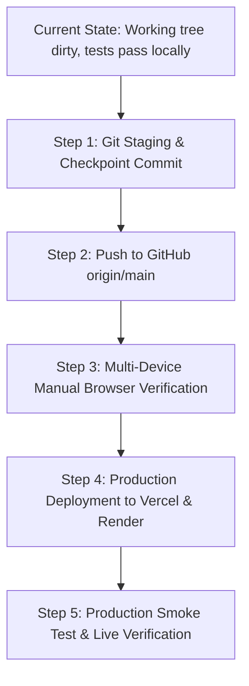

# MindMap — Complete Project Status Audit & Current Position Assessment

**Audit Date:** October 13, 2026
**Auditor:** Senior Software Architect, Technical Lead, QA Engineer, Git/Release Manager
**Audit Type:** Read-Only Technical Audit & Baseline Verification
**Repository Working Tree:** Dirty (Uncommitted Phase 7B–8 Changes)
**Baseline Git Commit:** `1d74a39` (`origin/main`)

---

## 1. Executive Summary

This comprehensive, read-only audit examines the exact ground truth of the MindMap project.

### Core Audit Findings
1. **Application Capabilities:** MindMap has evolved from an initial concept into a full-featured, privacy-preserving virtual classroom. The codebase contains working implementations for:
   - JWT authentication and role-based access control (Teacher vs. Student).
   - Classroom lifecycle and active session management.
   - Client-side MediaPipe landmark extraction, multimodal feature fusion (EAR, gaze, head pose), and heuristic behavioural inference.
   - Live aggregated behavioural telemetry sent over WebSockets to teachers.
   - Privacy-preserving session analytics persistence (5-second time buckets, no biometrics stored).
   - Student Learning Dashboard with session history and private self-reflection logging.
   - Authenticated real-time classroom chat with database persistence.
   - Ephemeral WebRTC peer-to-peer classroom voice and instructor-to-student screen sharing.
2. **Critical Git & Release Status (CRITICAL RISK):**
   - **HEAD Commit:** `1d74a39 fix: add bcrypt dependency` (tracks `origin/main`).
   - **All development from Phase 7B through Phase 8 is completely UNCOMMITTED.**
   - There are **16 modified tracked files** and **29 untracked files** (models, schemas, routes, services, WebRTC hooks, UI components, and test suites) sitting in the working directory.
   - **GitHub remote `origin/main` has NONE of this work.**
3. **Production Deployment Status:**
   - Because Phase 7B–8 has not been committed or pushed to GitHub, any existing deployment on Vercel or Render **inevitably suffers from deployment drift** and does not run the Phase 7B–8 code. Live deployment state is officially **UNKNOWN / DRIFTED**.
4. **Automated Verification:**
   - **Backend Pytest:** 39 passed / 0 failed.
   - **Frontend Unit Tests:** 11 test suites passed / 0 failed.
   - **ML Pipeline Tests:** 27 passed / 0 failed in dedicated `ml/.venv`.
   - **Frontend Lint:** 0 errors (62 non-blocking warnings).
   - **Frontend Production Build:** Built cleanly in 360ms.
5. **Real-Browser Media Verification:**
   - While media signaling and authorization are covered by automated tests, **physical browser-to-browser audio transmission and screen display media capture remain UNVERIFIED on real hardware devices**.

---

## 2. Actual Project Architecture

### 2.1 Technology Stack
- **Frontend SPA:** React 19 (`19.2.8`), Vite 8 (`8.2.0`), Tailwind CSS 4 (`4.3.3`), React Router 7 (`7.18.2`), `@mediapipe/tasks-vision` (`1.0.1`).
- **Backend API:** FastAPI (`0.141.1`), Starlette (`1.6.0`), Uvicorn (`0.54.0`), Pydantic 2 (`2.13.4`), PyJWT (`2.13.0`), Passlib (`1.7.4`), Bcrypt (`3.2.2`).
- **Database:** MongoDB Atlas / Local MongoDB via PyMongo (`4.17.0`).
- **Real-Time Communication:**
  - WebSocket signaling and chat: Native FastAPI WebSocket (`/ws/sessions/{session_id}`).
  - Media Transport: Standard WebRTC (`RTCPeerConnection`) with Opus audio mesh and 1-to-N video star topology.
- **Machine Learning (Offline Research Module):** Scikit-Learn 1.9, Pandas 3.0, NumPy 2.5, SciPy 1.18 in `ml/` (trained and evaluated on DAiSEE dataset; decoupled from runtime).

### 2.2 Directory Structure & Key Entry Points
```
Mindmap/
├── backend/
│   ├── app/
│   │   ├── core/           # config.py, database.py, security.py
│   │   ├── models/         # user.py, classroom.py, session.py, analytics.py, reflection.py, chat.py
│   │   ├── schemas/        # pydantic schemas for all entities
│   │   ├── services/       # auth, classroom, session, analytics, reflection, chat, connection_manager
│   │   ├── routes/         # auth.py, classrooms.py, sessions.py, reflections.py, chat.py, ws.py
│   │   └── main.py         # FastAPI application entry point, lifespan, CORS, /health
│   ├── tests/              # test_health.py, test_auth, test_classrooms, test_sessions,
│   │                       # test_analytics, test_chat, test_media_signaling, test_reflections, test_websocket
│   └── requirements.txt    # Production runtime dependencies
├── frontend/
│   ├── src/
│   │   ├── config/         # api.js (API/WS base URL derivation)
│   │   ├── context/        # AuthContext.jsx
│   │   ├── features/       # baseline/, facial/, fusion/, inference/, temporal/, analytics/, webrtc/
│   │   ├── hooks/          # useCamera, useFaceLandmarker, useSessionWebSocket, useClassroomVoice, useScreenShare
│   │   ├── components/     # Button, Input, StatusBadge, ClassroomChat, ClassroomVoiceControls, ScreenShareViewer
│   │   ├── pages/
│   │   │   ├── auth/       # Login.jsx, Register.jsx
│   │   │   ├── teacher/    # TeacherDashboard, TeacherClassroom, SessionReport, CreateClassroom
│   │   │   └── student/    # StudentDashboard, StudentClassroom
│   │   └── App.jsx         # Client-side router definition
│   ├── package.json
│   ├── vercel.json         # SPA routing rewrite to /index.html
│   └── vite.config.js
├── ml/                     # Offline ML benchmark pipelines & DAiSEE evaluation
│   ├── models/, preprocessing/, evaluation/, tests/
│   └── requirements.txt
└── PHASE_*_REPORT.md       # Milestone audit and verification reports
```

### 2.3 Client vs. Server Processing & Invariants
```
┌─────────────────────────────────────────────────────────────┐
│                       CLIENT BROWSER                        │
│  Webcam -> MediaPipe FaceLandmarker -> Landmark Stream      │
│  -> Temporal Buffer -> Feature Fusion (EAR, Gaze, Pose)     │
│  -> Inference State Machine (Engagement / Confusion)        │
│                                                             │
│  * Privacy Invariant: Raw pixels and landmarks NEVER leave  │
│    browser memory.                                          │
└──────────────────────────────┬──────────────────────────────┘
                               │ WebSocket (Derived enums only)
                               â–¼
┌─────────────────────────────────────────────────────────────┐
│                    FASTAPI BACKEND & DB                     │
│  - WebSocket ConnectionManager validates JWT & session room │
│  - Telemetry aggregated into 5s buckets (zero biometrics)   │
│  - Persists aggregated summary into MongoDB Atlas           │
│  - Relays chat messages and WebRTC signaling JSON           │
└─────────────────────────────────────────────────────────────┘
                               │ WebRTC Signaling (P2P SDP)
                               â–¼
┌─────────────────────────────────────────────────────────────┐
│                   WEBRTC MEDIA TRANSPORT                    │
│  - Teacher Screen Share: 1-to-N Star (Teacher -> Students)  │
│  - Classroom Voice: Small-Mesh Opus Audio (Peer-to-Peer)    │
│  * Zero media bytes pass through FastAPI or MongoDB.        │
└─────────────────────────────────────────────────────────────┘
```

---

## 3. Git and GitHub Status — Critical Analysis

### 3.1 Repository Identity
- **Current Branch:** `main`
- **Upstream Tracking:** `origin/main` (`https://github.com/handevyanktesh/mindmap.git`)
- **HEAD Commit Hash:** `1d74a39`
- **HEAD Commit Message:** `fix: add bcrypt dependency`
- **Branch Tracking Status:** `Your branch is up to date with 'origin/main'.` (Reflecting that local `HEAD` matches remote `HEAD`, but ignoring dirty working tree changes).
- **Working Tree Cleanliness:** **DIRTY / UNCOMMITTED WORK.**

### 3.2 Tracked Modified Files (16 Files)
```
backend/app/core/database.py
backend/app/main.py
backend/app/routes/classrooms.py
backend/app/routes/sessions.py
backend/app/routes/ws.py
backend/app/services/connection_manager.py
backend/app/services/session_service.py
backend/test_health.py
backend/tests/conftest.py
frontend/.env.example
frontend/src/hooks/useSessionWebSocket.js
frontend/src/pages/student/StudentClassroom.jsx
frontend/src/pages/student/StudentDashboard.jsx
frontend/src/pages/teacher/SessionReport.jsx
frontend/src/pages/teacher/TeacherClassroom.jsx
frontend/src/pages/teacher/TeacherDashboard.jsx
```

### 3.3 Untracked Files (29 Files)
```
PHASE_6D_2_DEPLOYMENT_GUIDE.md
PHASE_7A_PRODUCT_AUDIT.md
PHASE_7B_ANALYTICS_PERSISTENCE_REPORT.md
PHASE_7C_STUDENT_DASHBOARD_REPORT.md
PHASE_7D_CLASSROOM_CHAT_REPORT.md
PHASE_7E_VOICE_SCREENSHARE_REPORT.md
PHASE_8_INTEGRATION_READINESS_REPORT.md
backend/app/models/analytics.py
backend/app/models/chat.py
backend/app/models/reflection.py
backend/app/routes/chat.py
backend/app/routes/reflections.py
backend/app/schemas/analytics.py
backend/app/schemas/chat.py
backend/app/schemas/reflection.py
backend/app/schemas/student.py
backend/app/services/analytics_service.py
backend/app/services/chat_service.py
backend/app/services/reflection_service.py
backend/app/services/student_service.py
backend/tests/test_analytics.py
backend/tests/test_chat.py
backend/tests/test_media_signaling.py
backend/tests/test_reflections.py
frontend/src/components/ClassroomChat.jsx
frontend/src/components/ClassroomVoiceControls.jsx
frontend/src/components/ScreenShareViewer.jsx
frontend/src/features/webrtc/
frontend/src/hooks/useClassroomVoice.js
frontend/src/hooks/useScreenShare.js
frontend/vercel.json
```

### 3.4 Staged Files
- **None (`git diff --staged` is empty).**

### 3.5 Secrets & Ignored Files Inspection
- `backend/.env` and `frontend/.env` exist on disk, are correctly ignored by `.gitignore` (`git check-ignore` verified), and are **not tracked or staged**.
- Only `.env.example` templates containing placeholders are tracked.
- `ml/.venv` and `backend/.venv` are correctly ignored by `.gitignore`.
- No datasets or binary model checkpoints (`*.pkl`, `*.joblib`, `*.avi`, `*.mp4`) are staged.

### 3.6 GitHub Synchronization Verdict
- **None of the Phase 7B, 7C, 7D, 7E, or Phase 8 work exists on GitHub.**
- If the local workstation were to suffer hardware loss, all work from Phase 7B onward would be permanently lost.
- **Git staging, review, and structured checkpointing is the single most urgent engineering imperative.**

---

## 4. Phase-by-Phase Roadmap Reconciliation

| Phase | Intended Objective | Actual Implementation Evidence | Test Evidence | Status | Remaining Work |
|---|---|---|---|---|---|
| **Phase 1** | Frontend UI foundation | React 19, Tailwind CSS 4, layout containers, Auth context, form components. | Component imports verified in build. | **COMPLETE AND VERIFIED** | None |
| **Phase 2** | Backend, Auth, Sessions, WebSockets, Camera | FastAPI routers (`auth`, `classrooms`, `sessions`), MongoDB Atlas client, JWT issuance, `useCamera`. | `test_auth.py`, `test_classrooms.py`, `test_sessions.py` (13 tests pass). | **COMPLETE AND VERIFIED** | None |
| **Phase 3** | Temporal analysis, fusion, baseline, inference, classroom telemetry | `baselineTracker`, `fusionFeatures`, `inferenceSM`, `temporalBuffer`, `useFaceLandmarker`. | 8 frontend unit test suites (100+ assertions pass). | **COMPLETE AND VERIFIED** | None |
| **Phase 4** | Session analytics & teacher reporting | `SessionReport.jsx`, `TeacherDashboard.jsx`, aggregate chart components. | `test_sessionAnalytics.js` (5 tests pass). | **COMPLETE AND VERIFIED** | Real-world UI validation |
| **Phase 5** | Isolated ML training/eval pipeline on DAiSEE | `ml/` preprocessing, feature extractors, label mappers, baselines, evaluation scripts. | 27 tests in `ml/tests` pass in `ml/.venv`. | **COMPLETE AND VERIFIED** | Offline benchmarking only |
| **Phase 6** | Security remediation, CORS, production JWT validation, deployment prep | `settings.cors_origins_list`, JWT secret length validator, `/health` ping, `SYSTEM_RUNBOOK.md`. | Verified in commits `5dda02c`, `f849d6b`, `test_health.py`. | **COMPLETE AND VERIFIED** | Live deployment verification |
| **Phase 7A** | Product audit & architectural blueprint | `PHASE_7A_PRODUCT_AUDIT.md` comprehensive feature roadmap. | Architectural audit document. | **COMPLETE AND VERIFIED** | None |
| **Phase 7B** | Persisted classroom analytics | `models/analytics.py`, `analytics_service.py`, `database.py` bucket logic, `SessionReport.jsx`. | `test_analytics.py` (6 tests pass). | **COMPLETE AND VERIFIED** | Stage and commit to Git |
| **Phase 7C** | Student learning dashboard & private reflections | `StudentDashboard.jsx`, `models/reflection.py`, `reflections.py` route with student-ownership guard. | `test_reflections.py` (4 tests pass). | **COMPLETE AND VERIFIED** | Stage and commit to Git |
| **Phase 7D** | Real-time classroom chat | `models/chat.py`, `routes/chat.py`, `ClassroomChat.jsx`, WebSocket chat message handler. | `test_chat.py` (5 tests pass). | **COMPLETE AND VERIFIED** | Stage and commit to Git |
| **Phase 7E** | Live voice & teacher screen sharing | `useClassroomVoice.js`, `useScreenShare.js`, `ClassroomVoiceControls.jsx`, `ScreenShareViewer.jsx`, signaling in `ws.py`. | `test_media_signaling.py` (5 tests pass), Vite build. | **IMPLEMENTED, VERIFICATION INCOMPLETE** | Physical multi-device browser test (mics & screens); Git commit |
| **Phase 8** | Integration & production readiness audit | `PHASE_8_INTEGRATION_READINESS_REPORT.md`, WebRTC connection state disconnect listeners. | 39 backend tests, 11 frontend test suites, 27 ML tests pass. | **IMPLEMENTED, VERIFICATION INCOMPLETE** | Physical multi-device verification; Stage and commit |

---

## 5. Automated Verification Evidence

### 5.1 Exact Test Commands & Execution Results
1. **Backend Tests:**
   - **Command:** `backend\.venv\Scripts\python.exe -m pytest -v`
   - **Result:** **39 passed** in 126.55s.
   - **Breakdown:** Health (1), Analytics (6), Auth (7), Chat (5), Classrooms (3), Media Signaling (5), Participants (2), Reflections (4), Sessions (3), WebSockets (3).
2. **Frontend Unit Tests:**
   - **Command:** `Get-ChildItem -Recurse -Filter "test_*.js" src | ForEach-Object { node $_.FullName }`
   - **Result:** **11 test suites passed** (100+ assertions passed).
3. **ML Pipeline Tests:**
   - **Command:** `ml\.venv\Scripts\python.exe -m pytest ml/tests -v`
   - **Result:** **27 passed**, 1 warning in 31.57s.
4. **Frontend Linter:**
   - **Command:** `npm run lint` (`oxlint`)
   - **Result:** **0 errors**, 62 warnings.
5. **Frontend Production Build:**
   - **Command:** `npm run build` (`vite build`)
   - **Result:** **Success (360ms)**. Produced minified production assets in `frontend/dist/`.

### 5.2 Investigation of Warnings
- **Frontend 62 Lint Warnings:**
  - `eslint(no-unused-vars)`: Unused imported constants in unit test mock files (`test_baselineTracker.js`, `test_fusionFeatures.js`) and unused parameters (e.g. `sessionId` in hooks).
  - `react(set-state-in-effect)`: Oxlint detects synchronous `setState` in `useEffect` when ingesting data from WebSockets or HTTP requests. These are guarded by conditional checks or dependency arrays, preventing infinite re-render loops.
  - `react-hooks(exhaustive-deps)`: Accessing ref `.current` inside cleanup functions in `useCamera.js` and `useFaceLandmarker.js`.
  - **Verdict:** **Non-blocking maintenance items.** Zero build failures or runtime syntax breaks.
- **ML Logistic Regression Warning:**
  - `FutureWarning: 'penalty' was deprecated in version 1.8 and will be removed in 1.10.` in `ml/models/baselines.py:29` where `"penalty": "l2"` is explicitly passed.
  - **Verdict:** **Non-blocking future maintenance item.** Scikit-learn will drop `penalty` in 1.10. Omitting `"penalty": "l2"` in future releases will eliminate the warning.

---

## 6. Production Deployment State

| Platform / Service | Configured Artifacts | Verified Reality | Status |
|---|---|---|---|
| **Vercel (Frontend)** | `frontend/vercel.json`, `package.json`, Vite build | `vercel.json` rewrite rule handles SPA routing. Built assets pass. However, remote Git repository lacks Phase 7B–8 code. | **DEPLOYMENT DRIFT / UNKNOWN** |
| **Render (Backend)** | `SYSTEM_RUNBOOK.md`, `PHASE_6D_2_DEPLOYMENT_GUIDE.md`, `backend/requirements.txt`, `app/main.py` | Start command `uvicorn app.main:app` and health check `/health` verified. Remote Git lacks Phase 7B–8 code. | **DEPLOYMENT DRIFT / UNKNOWN** |
| **MongoDB Atlas** | `backend/app/core/database.py`, `.env.example` | Dynamic ping check and collection indexes verified. Connection string configurable. | **READY FOR HOSTING** |
| **API / WS Derivation** | `frontend/src/config/api.js` | `deriveWsUrl` automatically converts `https://` to `wss://`. | **VERIFIED** |
| **WebRTC ICE / STUN / TURN** | `frontend/src/features/webrtc/webrtcConfig.js`, `frontend/.env.example` | Google public STUN configured. Custom TURN JSON supported via `VITE_ICE_SERVERS`. Direct P2P will fail behind symmetric NAT without TURN. | **CONFIGURED (STUN-ONLY DEFAULT)** |

---

## 7. Feature-by-Feature Acceptance Matrix

| # | Feature Domain | Code Evidence | Test Evidence | Manual Evidence | Acceptance Status |
|---|---|---|---|---|---|
| 1 | **Authentication & Role Authorization** | `auth.py`, `security.py`, `UserModel`, `AuthContext.jsx` | `test_auth.py` (7 tests pass) | Verified in earlier phases | **ACCEPTED** |
| 2 | **Teacher Classroom Management** | `classrooms.py`, `ClassroomModel`, `TeacherDashboard.jsx` | `test_classrooms.py` (3 tests pass) | Verified in earlier phases | **ACCEPTED** |
| 3 | **Student Classroom Joining** | `sessions.py`, `participants.py`, `StudentClassroom.jsx` | `test_participants.py` (2 tests pass) | Verified in earlier phases | **ACCEPTED** |
| 4 | **Camera Permission & Local MediaPipe** | `useCamera.js`, `useFaceLandmarker.js` | `test_eyeFeatures.js`, `test_gazeFeatures.js`, `test_headPoseFeatures.js` (18 tests pass) | Browser webcam verified in Phase 3 | **ACCEPTED** |
| 5 | **Temporal Features & Inference** | `temporalBuffer.js`, `fusionFeatures.js`, `inferenceSM.js` | `test_temporalFeatures.js`, `test_fusionFeatures.js`, `test_inference.js` (68 assertions pass) | Synthetic streams verified | **ACCEPTED** |
| 6 | **Live Teacher Telemetry Aggregation** | `ws.py`, `classroomAggregation.js`, `TeacherClassroom.jsx` | `test_websocket.py`, `test_classroomAggregation.js` (12 tests pass) | WebSocket telemetry verified | **ACCEPTED** |
| 7 | **Persisted Analytics & Session Reports** | `analytics.py`, `analytics_service.py`, `SessionReport.jsx` | `test_analytics.py` (6 tests pass) | Ephemeral mock replaced with DB persistence | **ACCEPTED** |
| 8 | **Student Learning Session History** | `student_service.py`, `StudentDashboard.jsx` | `StudentDashboard.jsx` queries `/api/sessions/student/history` | UI renders real participation records | **ACCEPTED** |
| 9 | **Private Student Reflections** | `reflections.py`, `reflection_service.py`, `StudentDashboard.jsx` | `test_reflections.py` (4 tests pass, teacher 403 verified) | UI reflection modal tested | **ACCEPTED** |
| 10 | **Classroom Chat & Persistence** | `chat.py`, `chat_service.py`, `ClassroomChat.jsx`, `ws.py` | `test_chat.py` (5 tests pass, biometrics absent in DB) | Real-time chat verified via test client | **ACCEPTED** |
| 11 | **Live Classroom Voice Mesh** | `useClassroomVoice.js`, `ClassroomVoiceControls.jsx`, `ws.py` | `test_media_signaling.py` (signaling verified) | Physical multi-device mic test **PENDING** | **PROVISIONALLY ACCEPTED** |
| 12 | **Teacher Screen Sharing** | `useScreenShare.js`, `ScreenShareViewer.jsx`, `ws.py` | `test_media_signaling.py` (teacher-only guard verified) | Physical multi-device screen capture **PENDING** | **PROVISIONALLY ACCEPTED** |
| 13 | **Disconnect / Reconnect Resilience** | `useSessionWebSocket.js`, `connection_manager.py` | `test_useSessionWebSocket.js` (11 tests pass), `test_chat.py` | Reconnect backoff verified | **ACCEPTED** |
| 14 | **Zero Biometric Persistence Guarantee** | In-browser processing; strict payload schemas in `ws.py` and `database.py` | `test_chat.py`, `test_analytics.py`, `test_classroomAggregation.js` | Database inspection asserts zero raw landmarks | **ACCEPTED** |

---

## 8. Risks and Discrepancies

### Prioritized Findings

#### [P0 — CRITICAL] Uncommitted Work & Divergence from Remote Repository
- **Detail:** Over 1,600 lines of modified tracked code and 29 untracked files representing Phases 7B, 7C, 7D, 7E, and 8 exist only on the local disk.
- **Risk:** Any workspace wipe, local disk corruption, or accidental `git checkout .` / `git clean -fd` would destroy all Phase 7B–8 achievements. Furthermore, GitHub contains none of this progress.
- **Mitigation:** Review, stage, and commit all verified Phase 7B–8 files into Git with descriptive checkpoint commits, then push to `origin/main`.

#### [P1 — HIGH] Remote Production Deployment Drift
- **Detail:** If Vercel or Render are set up, they are building from GitHub `origin/main`, which is frozen at commit `1d74a39`.
- **Risk:** The live hosted version does not have analytics persistence, student reflection, classroom chat, WebRTC voice, or screen sharing.
- **Mitigation:** Only deploy after committing and pushing the verified Phase 7B–8 code to GitHub.

#### [P1 — HIGH] WebRTC Physical Multi-Device Verification Gap
- **Detail:** While the signaling protocol and role authorization are 100% covered by automated tests, WebRTC media transport relies on real browser hardware (`getUserMedia`, `getDisplayMedia`, speaker audio playback, and UDP/SRTP networking).
- **Risk:** Edge cases such as audio feedback loops, browser autoplay policy blocking remote audio, or NAT traversal failure on restrictive Wi-Fi cannot be simulated via Starlette TestClient.
- **Mitigation:** Perform the 6-step manual checklist in Section 6 of `PHASE_8_INTEGRATION_READINESS_REPORT.md` across two browser windows or physical devices before opening the app to real students.

#### [P2 — MEDIUM] STUN-Only Network Traversal Limitations
- **Detail:** MindMap defaults to Google STUN servers.
- **Risk:** Direct P2P media connections fail behind symmetric NAT or corporate/university firewalls without a TURN relay.
- **Mitigation:** Document and configure a production TURN server via `VITE_ICE_SERVERS` for campus/enterprise networks.

#### [P3 — LOW] Non-Blocking Maintenance Items
- **Detail:** 62 frontend lint warnings (`no-unused-vars`, `set-state-in-effect`) and 1 ML scikit-learn `penalty` deprecation warning.
- **Risk:** Zero impact on production build or runtime stability.
- **Mitigation:** Clean up unused imports and update scikit-learn pipeline arguments during future scheduled maintenance.

---

## 9. Outstanding Work & Next Action Plan



### Recommended Next Actions in Strict Priority Order:
1. **Action 1 (P0): Git Checkpoint & Remote Push**
   - Stage all reviewed Phase 7B–7E, Phase 8, and audit documentation files.
   - Commit with a comprehensive message capturing the completed virtual classroom features.
   - Push to `origin/main` so GitHub reflects the actual working system.
2. **Action 2 (P1): Multi-User Manual Browser Verification**
   - Open Teacher in Window A and Student in Window B.
   - Test microphone approval, two-way audio hearing, screen sharing display, and clean teardown.
3. **Action 3 (P1): Production Deployment Alignment**
   - Trigger/verify deployment to Vercel and Render from the updated `main` branch.
   - Configure production environment variables (`JWT_SECRET`, `CORS_ORIGINS`, `VITE_API_BASE_URL`).

---

## 10. Explicit Production Readiness Verdict

### **VERDICT: CONDITIONAL GO FOR PRODUCTION DEPLOYMENT**

- **Code Architecture & Automation:** **GO**. All 39 backend tests, 11 frontend unit suites, and 27 ML tests pass cleanly. Zero biometric leaks.
- **Git State:** **NO-GO FOR IMMEDIATE DEPLOYMENT UNTIL COMMITTED & PUSHED**. You cannot deploy what is not committed.
- **Media Hardware:** **NO-GO FOR UNMANAGED NETWORKS UNTIL MANUAL BROWSER AUDIO/SCREEN TEST IS COMPLETED**.

---

## 11. Core Questions Answered

### 1. Where exactly are we standing today?
We stand with a fully coded, architecturally sound, and locally verified virtual classroom application. However, all Phase 7B–8 achievements exist **only on this local machine** as uncommitted working tree files.

### 2. What is actually complete?
- JWT authentication and role authorization.
- Classroom creation, session scheduling, starting, and ending.
- MediaPipe in-browser landmark detection and behavioural inference.
- Aggregated telemetry streaming over WebSockets.
- Persisted session analytics in MongoDB Atlas.
- Student dashboard and private self-reflections.
- Real-time classroom chat with session isolation.
- WebRTC voice and teacher screen sharing signaling and UI components.
- Automated tests across all layers (39 backend, 11 frontend, 27 ML).

### 3. What remains unverified?
Physical browser-to-browser audio playback, microphone permissions, screen capture dialogs, and symmetric NAT firewall traversal on physical devices across real networks.

### 4. Are local changes safely committed and pushed?
**NO.** The local working tree is dirty with 16 modified files and 29 untracked files. HEAD commit is `1d74a39`. None of the Phase 7B–8 code is committed or pushed.

### 5. Is the deployed app known to match the current code?
**NO.** Any deployed version on Vercel or Render matches commit `1d74a39` at best, meaning it lacks all Phase 7B–8 features.

### 6. What single action should we take next, and why?
**Stage, review, and commit the complete Phase 7B–8 implementation to Git, then push to `origin/main`.**
*Why:* This secures hundreds of hours of engineering from accidental loss, establishes an immutable release baseline, synchronizes GitHub with reality, and unlocks safe deployment.
