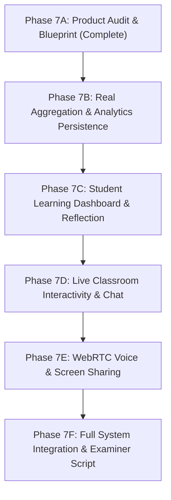

# MindMap Phase 7A — Product Audit and Implementation Blueprint

**Degree / Project Level:** Final-Year B.Tech Computer Science & Engineering (AI / ML)
**System Title:** MindMap — Real-Time Non-Invasive Student Behaviour Analysis for Virtual Classrooms
**Document Purpose:** Comprehensive architectural inventory, gap analysis, and phased implementation blueprint for evolving MindMap into a unified, privacy-first virtual classroom with live teaching, teacher historical analytics, and student personal self-reflection.
**Baseline Git Commit:** `1d74a39`

---

## 1. Executive Summary & Purpose

MindMap was engineered to address a fundamental challenge in remote and digital education: **how instructors can gauge real-time classroom comprehension and engagement without infringing upon student privacy or recording intrusive video feeds**.

Through Phases 1 through 6, MindMap established a verified, privacy-preserving core:
1. **Client-Side Computer Vision & Temporal Fusion:** Running MediaPipe Face Landmarker in WebAssembly on the student's browser to compute Eye Aspect Ratio (EAR), gaze vectors, and head pose angles entirely locally.
2. **Discrete Numerical Telemetry:** Emitting only sanitized discrete labels (`NORMAL_BEHAVIOUR`, `REDUCED_ENGAGEMENT_LIKE`, `LOW`, `ELEVATED`) over authenticated WebSockets at 1 Hz. Raw frames, coordinates, and biometrics never leave the student's machine.
3. **Hardened Infrastructure:** Full JWT authorization, CORS protection, Render/Vercel deployment readiness, and an active MongoDB health probe.

### The Phase 7 Objective
While the telemetry pipeline is mathematically and architecturally validated, the product experience is currently fragmented:
- The **Live Classroom** relies on a mock slide presentation and lacks audio/screen sharing, session chat, or interactive presentation capabilities.
- The **Teacher Analytics Dashboard** displays hardcoded mock historical sessions rather than genuine database records.
- The **Student Dashboard** is a static routing stub with zero personal reflection tools or session review history.

This document presents a rigorous product audit and an end-to-end implementation blueprint to unify MindMap into three cohesive, production-grade experiences:
1. **Live Classroom Experience:** Real-time instruction with teacher screen share/audio broadcast, session-scoped text chat, and a synchronized behavioural telemetry sidebar.
2. **Teacher Analytics Dashboard:** Authentic session-by-session historical metrics, aggregate trend visualization, and graceful empty states.
3. **Student Learning Dashboard:** Completely private, non-punitive session reflection, self-set learning goals, and engagement self-awareness tools.

---

## 2. Current-State Inventory & Codebase Inspection

A comprehensive read-only audit of the existing codebase was conducted across frontend components, backend routers, database schemas, and configuration files.

### 2.1 File Inspection Matrix

| Subsystem | File Inspected | Current Operational Status | Primary Functional Role & Observed Gaps |
| :--- | :--- | :--- | :--- |
| **Frontend Router** | `frontend/src/App.jsx` | Fully Operational | Defines public and dashboard routes. Missing dedicated student session history/reflection routes. |
| **Frontend Layout** | `frontend/src/layouts/DashboardLayout.jsx` | Fully Operational | Provides contextual navigation for `/student/*` and `/teacher/*`. Needs updated navigation links for student reflection portal. |
| **Teacher UI** | `frontend/src/pages/teacher/TeacherDashboard.jsx` | Incomplete / Mock Data | Fetches classrooms via REST, but hardcodes mock recent session rows (`Calculus I (Lecture 14)`). |
| **Teacher UI** | `frontend/src/pages/teacher/TeacherClassroom.jsx` | Partially Operational | Real-time session lifecycle and in-memory student WebSocket aggregation work. Lacks screen presentation, voice broadcast, and session chat. |
| **Teacher UI** | `frontend/src/pages/teacher/SessionReport.jsx` | Partially Operational | Renders session metadata from MongoDB and telemetry timeline from ephemeral browser `sessionStorage`. Displays empty state if accessed cold. |
| **Student UI** | `frontend/src/pages/student/StudentDashboard.jsx` | UI Placeholder | Static cards with links to Join Class and Device Check. Zero historical session metrics or personal reflection UI. |
| **Student UI** | `frontend/src/pages/student/DeviceCheck.jsx` | Stubbed Verification | Simulates webcam and microphone check with `setTimeout`. Real webcam pipeline is in `StudentClassroom.jsx`. |
| **Student UI** | `frontend/src/pages/student/StudentClassroom.jsx` | Partially Operational | MediaPipe landmark extraction and WebSocket telemetry stream work locally. Presentation area is a mock static slide with fake navigation buttons. |
| **Analytics** | `frontend/src/components/analytics/*` | Fully Operational | Pure SVG charts (`DistributionBarChart`, `ConfusionDistributionChart`, `TimelineTrendChart`, `MetricCard`) support both populated data and empty states. |
| **Backend Core** | `backend/app/main.py` | Fully Operational | FastAPI application with CORS middleware, health check, router mounting, and lifespan management. |
| **Backend WS** | `backend/app/routes/websocket.py` | Fully Operational | Authenticated WebSocket endpoint (`/ws/sessions/{session_id}`). Manages in-memory student telemetry broadcast. Lacks chat message handling. |
| **Backend Models** | `backend/app/models/*.py` | Partially Complete | Contains `UserModel`, `ClassroomModel`, `SessionModel`, and `ParticipantModel`. Lacks schemas for persisted session aggregate metrics and student reflections. |
| **Backend REST** | `backend/app/routes/sessions.py` | Partially Complete | Supports session creation, joining, ending, and summary metadata. Lacks persistence for aggregate metrics. |

---

## 3. Mock Data & Placeholder Inventory

To achieve examiner-grade credibility for a final-year B.Tech CSE (AI) demonstration, all placeholder and synthetic demo data must be identified and systematically replaced with authentic data models.

| File Path & Line Reference | Current Mock / Placeholder Implementation | Why It Currently Exists | Production Replacement Strategy |
| :--- | :--- | :--- | :--- |
| `frontend/src/pages/teacher/TeacherDashboard.jsx`<br>Lines 37–40 | Hardcoded `recentSessions` array:<br>`{ id: 'sess-01', title: 'Calculus I (Lecture 14)', date: 'Today, 10:00 AM', duration: '45m', students: 24, avgAttention: 82, peakConfusion: 18 }` | Demo placeholder created during initial UI prototyping before session persistence was designed. | Query `GET /api/teachers/sessions/history` to load authentic completed sessions with real aggregated metrics stored in MongoDB. |
| `frontend/src/pages/student/StudentDashboard.jsx`<br>Lines 25–65 | Static "Quick Actions" and "Upcoming Classes" cards with hardcoded text and static links. | Placeholder pending specification of the student experience. | Implement personal session history table (`GET /api/students/sessions/history`) and self-reflection log cards. |
| `frontend/src/pages/student/StudentClassroom.jsx`<br>Lines 214–235 | Static HTML slide canvas:<br>`"Lecture Slide #12 — Fundamental Theorem of Calculus"` with fake "Previous Slide" and "Next Slide" buttons. | Placeholder slide to give the student something to view while testing local MediaPipe webcam extraction. | Implement WebRTC screen share stream receiver / teacher presentation stage. |
| `frontend/src/pages/student/DeviceCheck.jsx`<br>Lines 25–48 | `setTimeout(..., 800)` simulating camera and microphone device detection. | Rapid UI prototype before hardware permissions were integrated. | Use standard `navigator.mediaDevices.getUserMedia` for genuine microphone and camera capability checks. |
| `frontend/src/pages/teacher/SessionReport.jsx`<br>Lines 78–92 | Reads `sessionStorage.getItem('mindmap_session_summary_' + id)` for behavioural timeline charts; displays empty banner if missing. | Behavioral telemetry was kept strictly ephemeral in memory to satisfy initial privacy constraints. | Safely persist non-identifying classroom aggregates (1-minute binned mean attention and confusion percentiles) to MongoDB upon session completion. |

---

## 4. Existing Data Sources & Persistence Analysis

### 4.1 What MongoDB Currently Stores
MindMap's MongoDB Atlas cluster currently manages four primary collections:
1. `users`: Authentication records, password hashes (bcrypt), user roles (`teacher`, `student`), full names, and timestamps.
2. `classrooms`: Classroom name, subject, teacher foreign key (`teacher_id`), join code, and student membership list.
3. `sessions`: Session ID, classroom foreign key (`classroom_id`), teacher foreign key (`teacher_id`), title, description, status (`active`, `ended`), and ISO timestamps (`started_at`, `ended_at`).
4. `participants`: Join records mapping `session_id`, `classroom_id`, `student_id`, `joined_at`, `left_at`, and connection status.

### 4.2 Where Telemetry Data Currently Resides
- **Student Local Device:** Local webcam stream $\rightarrow$ MediaPipe Face Landmarker $\rightarrow$ 478 3D mesh points $\rightarrow$ geometric EAR, gaze direction, head pose $\rightarrow$ temporal buffer (30 frames) $\rightarrow$ discrete state machine. **None of this is stored in any database or file.**
- **FastAPI WebSocket Layer:** In-memory dictionary in `SessionConnectionManager`. Student payloads are validated via Pydantic (`TelemetryPayload`: `attention_state`, `confusion_level`, `confidence`) and immediately fanned out to active teachers in the session room.
- **Teacher Browser Memory:** Ingested via WebSocket, buffered into React state (`liveTelemetry`), and aggregated in real-time. When the teacher clicks "End Session", `TeacherClassroom.jsx` computes an in-memory summary and writes it to browser `sessionStorage`.

### 4.3 Persistence Limitations & Vulnerabilities
1. **Cold Report Failure:** If a teacher ends a session on their laptop, they cannot view the behavioural graphs on their office workstation or after clearing browser cache because `sessionStorage` is device-bound and ephemeral.
2. **Missing Longitudinal Trends:** The teacher cannot view historical trends over weeks or months (e.g., "Has classroom confusion during Chapter 4 decreased across cohorts?") because session summaries are not stored in the database.
3. **Zero Student Self-Reflection History:** Students have no record of their past study sessions, self-set focus targets, or personal reflection notes.

### 4.4 The Privacy Invariant: Permissible vs Forbidden Persistence
To maintain our core privacy guarantees, the following invariant is strictly enforced:

```
┌─────────────────────────────────────────────────────────────┐
│ FORBIDDEN TO PERSIST (Client-Side Ephemeral Only)           │
├─────────────────────────────────────────────────────────────┤
│ ✕ Raw webcam video frames                                   │
│ ✕ MediaPipe 478 facial landmark coordinates                 │
│ ✕ Raw geometric signals (EAR, gaze vectors, head pitch/yaw) │
│ ✕ Per-student continuous behavioural timeseries in database │
│ ✕ Individual biometric student logs linked to student IDs   │
└─────────────────────────────────────────────────────────────┘
                             │
                             â–¼
┌─────────────────────────────────────────────────────────────┐
│ PERMISSIBLE TO PERSIST (Anonymized & Non-Punitive)          │
├─────────────────────────────────────────────────────────────┤
│ ✓ Classroom-wide aggregated metrics (mean attention %,      │
│   peak confusion %, 1-minute bucketed classroom percentiles)│
│ ✓ Session metadata (duration, student attendance count)    │
│ ✓ Student-authored personal reflection notes (visible       │
│   EXCLUSIVELY to the student who wrote them)                │
│ ✓ Student self-set goals (e.g. "Review Chapter 3 slides")   │
└─────────────────────────────────────────────────────────────┘
```

---

## 5. Blueprint: Experience 1 — The Live Classroom

The Live Classroom is the synchronous operational environment where instruction, collaboration, and behavioural telemetry converge.

```
┌───────────────────────────────────────────────────────────────────────────────┐
│                           MINDMAP LIVE CLASSROOM UI                           │
├───────────────────────────────────────────────────────┬───────────────────────┤
│ [Top Bar] Session Title | Live Status | 24 Active     │ [Sidebar Navigation]  │
│           Teacher Name  | Audio On    | Recording Off │ [Telemetry]  [Chat]   │
├───────────────────────────────────────────────────────┼───────────────────────┤
│                                                       │ (Telemetry Tab)       │
│  MAIN PRESENTATION STAGE                              │ ┌───────────────────┐ │
│  ┌─────────────────────────────────────────────────┐  │ │ Reporting: 24/24  │ │
│  │                                                 │  │ │ Attentive:   79%  │ │
│  │  Teacher Screen Share / Presentation Stream     │  │ │ Confusion:   12%  │ │
│  │  (Low-latency WebRTC 1080p / 30fps)             │  │ └───────────────────┘ │
│  │                                                 │  │ Real-time Trend (5m)  │
│  │                                                 │  │ [~~~~~/\~~~~_/\~~~~~] │
│  │                                                 │  │ ───────────────────── │
│  │                                                 │  │ (Chat Tab)            │
│  │                                                 │  │ Student A: "Can you   │
│  │                                                 │  │ explain slide 4?"     │
│  │                                                 │  │ Teacher: "Reviewing!" │
│  └─────────────────────────────────────────────────┘  │ [Type message...]     │
├───────────────────────────────────────────────────────┴───────────────────────┤
│ [Bottom Bar] [Mic Mute/Unmute] [Share Screen] [Raise Hand] [Leave/End Class]  │
└───────────────────────────────────────────────────────────────────────────────┘
```

### 5.1 Presentation Stage & Screen Sharing
- **Teacher Role:** Can broadcast their desktop, window, or browser tab using `navigator.mediaDevices.getDisplayMedia({ video: true, audio: true })`.
- **Student Role:** Receives the incoming video track in an HTML5 `<video>` element with hardware acceleration, responsive aspect ratio fitting, and full-screen toggle.
- **Fallbacks:** If no screen is shared, displays an elegant, branded MindMap lecture standby banner indicating "Instructor is lecturing — microphone active".

### 5.2 Voice Communication Architecture
- **Teacher Broadcast (1-to-Many):** Teacher audio is transmitted with high priority (opus, 48kHz, echo cancellation enabled).
- **Student Interaction (Push-to-Talk or Moderated Unmute):** To prevent classroom acoustic feedback, student microphones default to muted. Students can raise a digital hand or unmute to speak.
- **Local Audio Isolation:** Microphone audio for voice communication is completely independent of the webcam processing stream used by MediaPipe.

### 5.3 Session Chat System
- **Scope:** Scoped strictly to the active session ID.
- **Transport:** Delivered via the existing FastAPI WebSocket channel (`/ws/sessions/{session_id}`) using an authenticated event schema:
  ```json
  {
    "type": "chat_message",
    "session_id": "sess_abc123",
    "sender_id": "usr_stu456",
    "sender_name": "Arjun Sharma",
    "sender_role": "student",
    "text": "Could you clarify the derivation of the second integral?",
    "timestamp": "2026-10-13T10:15:32Z"
  }
  ```
- **Moderation:** Teacher can clear chat or disable chat during formal assessments.

### 5.4 Synchronized Behavioural Telemetry Sidebar
- **Teacher View:** Real-time classroom telemetry overview:
  - Total reporting students vs connected students.
  - Classroom Attention Gauge (% of reporting cohort in `NORMAL_BEHAVIOUR`).
  - Classroom Confusion Alert (% of reporting cohort in `ELEVATED` confusion).
  - 5-minute rolling sparkline showing engagement stability.
- **Student View:** Displays a reassuring "Local Privacy Guard Active" indicator showing camera status, frames processed per second, and local baseline calibration status. **Students do not see other students' signals.**

---

## 6. Blueprint: Experience 2 — Teacher Analytics Dashboard

The Teacher Analytics Dashboard enables instructors to review pedagogical effectiveness across past lectures, identify specific curriculum topics that triggered widespread confusion, and track cohort engagement trends over time.

```
┌───────────────────────────────────────────────────────────────────────────────┐
│                      TEACHER ANALYTICS & SESSIONS DASHBOARD                   │
├───────────────────────────────────────────────────────────────────────────────┤
│ [Quick Metrics]                                                               │
│ ┌───────────────────┐ ┌───────────────────┐ ┌───────────────────┐             │
│ │ Total Lectures    │ │ Avg Cohort Focus  │ │ Peak Confusion    │             │
│ │ 18 Completed      │ │ 81.4% (Normal)    │ │ 16.2% (Moderate)  │             │
│ └───────────────────┘ └───────────────────┘ └───────────────────┘             │
├───────────────────────────────────────────────────────────────────────────────┤
│ [Historical Sessions Table]                                                   │
│ Date        Title                 Duration  Students  Avg Focus  Confusion    │
│ 12 Oct 2026 Calculus I: L15       50 min    28        84%        11% [View]   │
│ 10 Oct 2026 Vector Fields: L14    45 min    26        76%        24% [View]   │
│ 08 Oct 2026 Linear Algebra: L13   52 min    27        82%        14% [View]   │
├───────────────────────────────────────────────────────────────────────────────┤
│ [Longitudinal Curriculum Trend]                                               │
│ Engagement vs Confusion over the last 10 lectures                             │
│ (SVG Line Chart with tooltips, trendlines, and topic tags)                    │
└───────────────────────────────────────────────────────────────────────────────┘
```

### 6.1 Replacement of Mock Historical Records
- Delete the hardcoded mock data in `TeacherDashboard.jsx`.
- Implement backend endpoint `GET /api/teachers/sessions/history` returning real completed session records with persisted aggregate summaries.
- If no sessions have been conducted, render an informative empty state card:
  > *"No classroom sessions recorded yet. Start your first lecture session above to begin generating engagement analytics."*

### 6.2 Persisted Session Summary (`SessionMetricsSummary`)
When a session concludes, the backend consolidates the in-memory window into a persisted document in `session_summaries`:
- `session_id`: Unique identifier linking to `sessions`.
- `average_attention_pct`: Average percentage of students in `NORMAL_BEHAVIOUR` throughout the lecture.
- `peak_confusion_pct`: Maximum instantaneous percentage of students exhibiting elevated confusion.
- `average_confidence`: Mean model estimation confidence.
- `timeline_buckets`: Array of 1-minute bucketed classroom metrics (timestamp, mean attention %, mean confusion %).
- `attendance_peak`: Maximum concurrent student count.

### 6.3 Deep-Dive Session Report Experience (`SessionReport.jsx`)
- Loads aggregate timeline directly from MongoDB via `GET /api/sessions/{session_id}/summary`.
- Eliminates reliance on `sessionStorage`, making reports permanent, shareable with co-instructors, and accessible across devices.
- Retains existing PDF export capability (`jsPDF`) with verified layout formatting.

---

## 7. Blueprint: Experience 3 — Student Learning Dashboard

The Student Learning Dashboard transforms MindMap from an observational tool into a student empowerment and self-reflection portal. It is explicitly designed to be **non-punitive, supportive, and completely confidential**.

```
┌───────────────────────────────────────────────────────────────────────────────┐
│                         STUDENT PERSONAL LEARNING PORTAL                      │
├───────────────────────────────────────────────────────────────────────────────┤
│ [Personal Greeting] Welcome back, Rahul! Keep up the great focus this week.  │
├───────────────────────────────────────────────────────────────────────────────┤
│ [My Session History & Reflection Log]                                         │
│ ┌───────────────────────────────────────────────────────────────────────────┐ │
│ │ 12 Oct 2026 • Calculus I: Lecture 15 (Attended 48 min)                    │ │
│ │ Focus Rating: Solid • Self-Reported Difficulty: Moderate                  │ │
│ │ Personal Notes: "Review integration by parts before Friday quiz."         │ │
│ │ [Edit Reflection Notes] [View Study Resources]                            │ │
│ └───────────────────────────────────────────────────────────────────────────┘ │
├───────────────────────────────────────────────────────────────────────────────┤
│ [Personal Learning Goals]                                                     │
│ [x] Attend all 3 Math lectures this week                                      │
│ [ ] Complete 20-minute review of difficult concepts                           │
│ [+ Add Personal Focus Goal]                                                   │
├───────────────────────────────────────────────────────────────────────────────┤
│ [Privacy Seal] Your reflections and study notes are 100% private.             │
│ Instructors can NEVER see your individual session reflections or notes.       │
└───────────────────────────────────────────────────────────────────────────────┘
```

### 7.1 Confidentiality & Non-Punitive Framing
- **Core Ethical Principle:** MindMap is an educational aid, not a surveillance system.
- **Privacy Wall:** Teachers have **zero access** to student reflection notes, personal focus scores, or self-ratings.
- **Constructive Language:** UI avoids terms like "Distracted", "Inattentive", or "Failed Attention". It uses empowering terms: "Focus Flow", "Re-engagement Opportunity", "Challenging Topic".

### 7.2 Personal Session History & Reflection Notes
- Displays lectures the student actually attended (queried via `GET /api/students/sessions/my-history` joining `participants` and `sessions`).
- Allows students to record personal notes for each session:
  - What concepts felt clear vs confusing?
  - Action items for self-study.
  - Optional self-assessed engagement rating (1 to 5 stars).

### 7.3 Goal Setting & Habit Tracking
- Simple, client-side/database-persisted checklist for academic habits:
  - Target weekly study hours.
  - Review flags for sessions where confusion was self-identified.
  - Preparation reminders for upcoming scheduled sessions.

---

## 8. WebRTC Media Architecture Evaluation & Recommendation

To enable teacher screen sharing and voice communication alongside MindMap's existing WebSocket telemetry, we evaluate the architectural options for media transport.

### 8.1 Evaluated Architecture Options

| Architecture Option | Topology & Protocol | Bandwidth & Server Load | Scalability (20–50 Students) | Complexity & Maintenance | Fit for MindMap |
| :--- | :--- | :--- | :--- | :--- | :--- |
| **Option A: Full P2P WebRTC Mesh** | Peer-to-peer mesh between all participants | Massive client uplink ($N \times (N-1)$ connections) | Fails completely at $N > 4$ students | Low server setup, extreme client burden | **Rejected:** Cannot support standard classroom sizes. |
| **Option B: 1-to-Many Teacher Broadcast via SFU (LiveKit / Mediasoup)** | Selective Forwarding Unit (SFU) forwards teacher's video/audio tracks to students | Single teacher uplink; SFU fans out RTP packets to students | Scales smoothly to hundreds of students | Requires running or paying for dedicated SFU media server | **Feasible for enterprise, but adds external infrastructure dependency.** |
| **Option C: Hybrid Broadcast (WebRTC P2P for Teacher $\rightarrow$ Student Broadcast + FastAPI WebSocket Signaling)** | Teacher acts as single-stream broadcast source. WebRTC tracks established using FastAPI WebSocket for SDP/ICE signaling. Students are receive-only for video/audio. | Teacher sends 1 video track and 1 audio track; students send lightweight audio only when unmuted. | Scales efficiently for typical academic cohorts (10–30 students). | Native to existing FastAPI WebSocket pipeline with zero external server dependencies. | **Recommended for MindMap Phase 7:** Cleanest architectural match with existing stack. |

### 8.2 Recommended Architecture: Hybrid WebRTC Broadcast with WebSocket Signaling

```
                       [Teacher Browser]
                        │             │
        WebRTC Offer    │             │  DisplayMedia (Video) + UserMedia (Mic)
      via FastAPI WSS   â–¼             â–¼  Direct WebRTC PeerConnection
    [FastAPI Signaling /ws] ──────► [Student Browser(s)]
           │                            │
           │ (Lightweight SDP/ICE)      │ (Low-latency Audio/Video Playback)
           â–¼                            â–¼
    [In-Memory Router]           [HTML5 <video> & AudioContext]
           │
           │ (Independent Telemetry Stream: 1 Hz JSON)
           â–¼
    [FastAPI Telemetry Handler] ──► [Teacher Dashboard Sidebar]
```

#### Key Implementation Decisions:
1. **Separation of Concerns:**
   - **Video/Audio Media:** Handled via standard HTML5 WebRTC `RTCPeerConnection` (browser-native, zero plugins, hardware-accelerated).
   - **Signaling:** Multiplexed over our existing, authenticated FastAPI WebSocket connection (`/ws/sessions/{session_id}`).
   - **Telemetry:** Completely decoupled from media tracks. Telemetry continues to flow as lightweight JSON messages at 1 Hz.
2. **Bandwidth Optimization:**
   - Teacher screen share is optimized for text/slides: 1080p, 15–30 fps, variable bitrate (contentHint: `'detail'`).
   - Voice is prioritized with Opus audio codec (32 kbps, stereo=0, echo cancellation).

---

## 9. Backend & Database Schema Blueprint

To support historical session analytics, chat messaging, and private student reflections, the backend data models must be extended.

### 9.1 New Model: `SessionMetricsSummaryModel`
*Collection:* `session_summaries`
*Access Policy:* Read access granted to the classroom teacher; strictly aggregated and anonymized.

```python
class TimelineBucket(BaseModel):
    timestamp_minute: int                # Minute offset from session start (0, 1, 2...)
    average_attention_pct: float         # Percentage of cohort with NORMAL_BEHAVIOUR
    elevated_confusion_pct: float        # Percentage of cohort with ELEVATED confusion
    reporting_students: int              # Active students reporting telemetry

class SessionMetricsSummaryModel(BaseModel):
    id: PyObjectId = Field(default_factory=PyObjectId, alias="_id")
    session_id: str                      # Foreign key to sessions collection
    classroom_id: str                    # Foreign key to classrooms collection
    teacher_id: str                      # Teacher owner
    duration_seconds: int                # Total session active duration
    peak_students: int                   # Maximum concurrent participant count
    average_attention_pct: float         # Mean attention across entire session
    peak_confusion_pct: float            # Peak confusion percentage observed
    average_confidence: float            # Mean model prediction confidence
    timeline: List[TimelineBucket]       # 1-minute bucketed classroom trend
    created_at: datetime = Field(default_factory=datetime.utcnow)
```

### 9.2 New Model: `StudentReflectionModel`
*Collection:* `student_reflections`
*Access Policy:* Read and write access restricted **exclusively** to the owning `student_id`. Teachers and co-students cannot query this collection.

```python
class StudentReflectionModel(BaseModel):
    id: PyObjectId = Field(default_factory=PyObjectId, alias="_id")
    session_id: str                      # Foreign key to sessions collection
    student_id: str                      # Foreign key to users collection
    classroom_id: str                    # Foreign key to classrooms collection
    session_title: str                   # Cached for display convenience
    self_reported_focus: int             # Optional self-rating (1 to 5)
    concept_clarity: str                 # "Clear", "Challenging", "Needs Review"
    reflection_notes: str                # Personal markdown/plain text notes
    action_items: List[str]              # Personal study goals / tasks
    created_at: datetime = Field(default_factory=datetime.utcnow)
    updated_at: datetime = Field(default_factory=datetime.utcnow)
```

### 9.3 WebSocket Protocol Extension: Chat & Signaling Events
The existing WebSocket message schema in `backend/app/routes/websocket.py` is extended to support three distinct event types:

```python
class WSIncomingMessage(BaseModel):
    type: Literal["telemetry", "chat_message", "webrtc_signal"]
    payload: dict

# Event 1: Telemetry (Existing, unchanged)
# type: "telemetry", payload: { attention_state, confusion_level, confidence }

# Event 2: Chat Message
# type: "chat_message", payload: { session_id, text, timestamp }

# Event 3: WebRTC Signal
# type: "webrtc_signal", payload: { target_peer_id, sdp_or_ice, signal_type }
```

---

## 10. Phased Implementation Roadmap (Phases 7B through 7F)

To ensure stability and maintain continuous test passing, development is divided into five sequential, verifiable phases.



### Milestone Specifications

```carousel
### Phase 7B: Analytics Persistence & Real Teacher Dashboard
**Objective:** Replace all mock data on Teacher Dashboard with authentic MongoDB persistence.
- Implement `SessionMetricsSummaryModel` in backend.
- Update `TeacherClassroom.jsx` session conclusion logic to transmit the aggregated timeline summary to `POST /api/sessions/{session_id}/finalize`.
- Implement `GET /api/teachers/sessions/history` and `GET /api/sessions/{session_id}/summary` reading from MongoDB.
- Refactor `TeacherDashboard.jsx` to render real database records with graceful empty states.
- Refactor `SessionReport.jsx` to load permanently from MongoDB instead of ephemeral `sessionStorage`.
- **Acceptance Criteria:** Zero mock rows in Teacher Dashboard; session reports load across any browser or incognito session.
<!-- slide -->
### Phase 7C: Student Learning Dashboard & Personal Reflection
**Objective:** Create the private student self-reflection portal and session history.
- Implement `StudentReflectionModel` and routes in `backend/app/routes/reflections.py`.
- Add student history endpoint `GET /api/students/sessions/my-history`.
- Build the Student Learning Dashboard UI (`StudentDashboard.jsx`) with attendance history, non-punitive focus reflection, and personal study goals.
- Enforce strict authorization: verify that students can only access their own reflections and teachers receive 403 Forbidden.
- **Acceptance Criteria:** Student can view past attended lectures, save personal reflection notes, and manage self-study goals; zero surveillance language.
<!-- slide -->
### Phase 7D: Live Classroom Interactivity & Session Chat
**Objective:** Add authenticated real-time chat and participant presence to the live classroom.
- Extend `SessionConnectionManager` in `backend/app/routes/websocket.py` to handle `chat_message` events with role tags.
- Build clean, collapsible chat panel component in `frontend/src/components/classroom/ChatPanel.jsx`.
- Implement live participant list with active reporting status.
- Add teacher moderation controls (clear chat, toggle student messaging).
- **Acceptance Criteria:** Students and teachers can exchange instant text messages in active sessions; chat persists in-session and resets cleanly upon termination.
<!-- slide -->
### Phase 7E: WebRTC Voice & Teacher Screen Sharing
**Objective:** Integrate live teacher screen broadcast and audio communication.
- Implement WebRTC signaling protocol over the existing WebSocket connection (`webrtc_signal` type).
- Build `TeacherScreenShare.jsx` using `navigator.mediaDevices.getDisplayMedia`.
- Build student presentation receiver canvas in `StudentClassroom.jsx` replacing the static mock slide.
- Integrate push-to-talk voice audio channel with noise suppression.
- Implement graceful fallbacks for unsupported browsers or low-bandwidth conditions.
- **Acceptance Criteria:** Teacher can share desktop/slides; students see live presentation stream with low latency; audio operates smoothly alongside MediaPipe.
<!-- slide -->
### Phase 7F: Full System Integration, Verification & Viva Runbook
**Objective:** Comprehensive end-to-end testing, performance verification, and examiner viva script.
- Execute automated backend, ML, and frontend test suites.
- Perform multi-client end-to-end simulation (1 teacher + 3 student browsers concurrently).
- Verify privacy boundary invariants: confirm zero raw frames or landmarks leave any client.
- Produce `EXAMINER_DEMO_RUNBOOK.md` with step-by-step demonstration walkthrough for viva examiners.
- Create clean Git checkpoint commit.
- **Acceptance Criteria:** 100% test pass rate; zero console errors; flawless live demonstration flow matching B.Tech viva criteria.
```

---

## 11. Smallest Safe Next Implementation Step (Phase 7B)

The immediate next step is **Phase 7B: Real Aggregation & Analytics Persistence**.

### Prerequisites & Guardrails
- **No breaking changes:** Phase 7B touches only session summary persistence and teacher dashboard display.
- **Privacy preservation:** Telemetry aggregation happens at the classroom level (averages and percentages); no individual biometric records are written to MongoDB.
- **Scope boundary:** Do not begin WebRTC audio/video or chat implementation in Phase 7B.

### Phase 7B Work Package
1. **Backend Model:** Define `SessionMetricsSummaryModel` in `backend/app/models/session_summary.py`.
2. **Backend Endpoints:**
   - `POST /api/sessions/{session_id}/finalize`: Ingests and persists the final session aggregate summary.
   - `GET /api/teachers/sessions/history`: Fetches completed sessions with aggregated metrics for the authenticated teacher.
   - `GET /api/sessions/{session_id}/summary`: Returns the permanent session report data.
3. **Frontend Integration:**
   - Update `TeacherClassroom.jsx` to call `/finalize` upon ending a session.
   - Update `TeacherDashboard.jsx` to fetch real history from `/history` and remove hardcoded mock array.
   - Update `SessionReport.jsx` to fetch directly from `/summary`.
4. **Verification:** Run `pytest` backend test suite and verify UI empty and populated states.

---

## 12. Verification & Traceability Checklist

| Requirement | Audit Finding / Specification | Phase Responsible |
| :--- | :--- | :--- |
| **All Mock Data Identified** | Catalogued lines in `TeacherDashboard`, `StudentDashboard`, `StudentClassroom`, `DeviceCheck`. | Phase 7A (Documented) |
| **Live Classroom Experience** | Teacher screen sharing, voice audio, session chat, telemetry sidebar. | Phases 7D & 7E |
| **Teacher Analytics Experience** | Longitudinal historical sessions, genuine aggregated metrics, PDF export. | Phase 7B |
| **Student Learning Experience** | Personal attendance history, non-punitive self-reflection, study goals. | Phase 7C |
| **Privacy Boundary Guarantee** | Zero webcam frames, landmarks, or biometrics leave the browser. | Invariant across all phases |
| **WebRTC Media Evaluated** | Hybrid broadcast (WebRTC P2P + WebSocket signaling) recommended over heavy external SFU. | Phase 7A (Documented) |
| **Continuous Test Integrity** | All existing tests preserved; zero regressions during progressive enhancement. | Phases 7B–7F |
