# MindMap Phase 7E — Live Voice and Teacher Screen Sharing Report

**Date:** October 13, 2026
**Status:** Complete & Verified
**Milestone:** Phase 7E — Live Classroom Voice & Teacher Screen Sharing

---

## 1. Executive Summary

Phase 7E has successfully added real-time classroom voice and instructor screen sharing to MindMap. The implementation extends the existing classroom architecture without introducing third-party SaaS SDKs or mutating the project's zero-cost Vercel/Render hosting setup:

1. **Zero Media Backend Load:** Raw audio and video streams **never** touch FastAPI or MongoDB Atlas. Media is transported exclusively peer-to-peer via standard browser `RTCPeerConnection` (WebRTC).
2. **Server-Authoritative Signaling:** The existing FastAPI WebSocket connection manager relays lightweight JSON signaling messages (`webrtc_signal`, `screenshare_started`, `screenshare_stopped`, `voice_join`, `voice_leave`, `voice_status`, `get_peers`).
3. **Strict Role Authorization:** Screen sharing initiation and termination are strictly restricted to authenticated teachers (`role == "teacher"`). Any attempt by a student to broadcast screen sharing is blocked server-side.
4. **Resilient Local Voice Pipeline:** Audio capture uses WebRTC Opus with hardware echo cancellation, noise suppression, and auto-gain control. Local speech activity detection is performed in-browser using Web Audio `AnalyserNode`, rendering real-time speaking pulses.
5. **Privacy Invariant Preserved:** No raw camera frames, facial landmarks, EAR, gaze vectors, or head-pose data are ever broadcast or stored. Ephemeral media streams are unrecorded and never written to database collections.

---

## 2. Media Architecture & Topology

### 2.1 Screen Sharing: 1-to-N Star Topology
- **Teacher (Broadcaster):** Captures high-definition screen stream via `navigator.mediaDevices.getDisplayMedia({ video: { cursor: 'always' }, audio: false })`. When sharing begins, the teacher broadcasts `screenshare_started` over the session WebSocket and spawns `RTCPeerConnection` sender tracks for connected students. Native browser unshare buttons (`track.onended`) cleanly trigger teardown and broadcast `screenshare_stopped`.
- **Students (Receivers):** Ingest incoming WebRTC video tracks via `ontrack` in `useScreenShare.js` and render the stream in `ScreenShareViewer.jsx` with responsive aspect-ratio containment and optional fullscreen toggle. Students have receive-only peer connections.

### 2.2 Voice: Decentralized Mesh Topology
- Each active participant opting into audio calls `navigator.mediaDevices.getUserMedia({ audio: true, video: false })`.
- Mics start muted by default to avoid classroom audio feedback.
- Each joined peer maintains direct audio `RTCPeerConnection` links to other voice participants in the active session.
- Local voice activity detection runs a 100ms polling loop on `AudioContext` and `AnalyserNode` frequency bins (threshold: RMS amplitude > 18) to provide visual speaker indicators without streaming raw waveforms.

### 2.3 Signaling Lifecycle
All signaling messages pass through the existing session endpoint `/ws/sessions/{session_id}`:

```mermaid
sequenceDiagram
    autonumber
    actor Teacher as Teacher (Host)
    participant WS as FastAPI WebSocket
    actor Student as Student (Peer)

    Note over Teacher,Student: Session Joined & WebSocket Connected

    Teacher->>WS: screenshare_started
    WS->>Student: screenshare_started {teacher_id, teacher_name}
    Teacher->>WS: webrtc_signal {target_id: student_id, signal: SDP_Offer, media: "screen"}
    WS->>Student: webrtc_signal {sender_id: teacher_id, signal: SDP_Offer, media: "screen"}
    Student->>WS: webrtc_signal {target_id: teacher_id, signal: SDP_Answer, media: "screen"}
    WS->>Teacher: webrtc_signal {sender_id: student_id, signal: SDP_Answer, media: "screen"}
    Note over Teacher,Student: P2P ICE Negotiation Complete
    Teacher-->>Student: Direct WebRTC SRTP/UDP Video Stream (Bypasses Server)

    Student->>WS: voice_join
    WS->>Teacher: voice_peer_joined {user_id, role}
    Student->>WS: webrtc_signal {target_id: teacher_id, signal: SDP_Offer, media: "voice"}
    WS->>Teacher: webrtc_signal {sender_id: student_id, signal: SDP_Offer, media: "voice"}
    Teacher-->>Student: Direct WebRTC Audio (Opus)
```


---

## 3. STUN/TURN & Network Traversal Requirements

- **STUN Server Configuration:** Configured in `frontend/src/features/webrtc/webrtcConfig.js`. Default public STUN:
  - `stun:stun.l.google.com:19302`
- **Configurability:** Operators can set `VITE_ICE_SERVERS` in frontend environment variables with a JSON array containing custom STUN or TURN credentials:
  ```json
  [
    { "urls": "stun:stun.l.google.com:19302" },
    { "urls": "turn:turn.yourdomain.com:3478", "username": "mindmap", "credential": "secretpassword" }
  ]
  ```
- **NAT Traversal Constraints:**
  - **Direct P2P (STUN):** Sufficient when users are on typical residential connections, universities with non-symmetric NAT, or the same local network.
  - **Symmetric NAT / Strict Firewalls:** If a school or enterprise network utilizes symmetric NAT, direct peer connections fail without an intermediate TURN relay. Configuring Coturn or a managed TURN provider (Twilio / Metered) via `VITE_ICE_SERVERS` fulfills strict traversal requirements.

---

## 4. Participant Capacity & Resource Implications

| Metric | Mesh / Star WebRTC | external SFU (Future) |
|---|---|---|
| **Practical Session Size** | 10–15 students | 50–200+ students |
| **Teacher Upload Bandwidth** | $\approx 1.5\text{ Mbps} \times N$ students | $\approx 2.0\text{ Mbps}$ total (single uplink) |
| **Student Download Bandwidth** | $\approx 1.5\text{ Mbps}$ screen + $50\text{ kbps} \times M$ voice | $\approx 1.5\text{ Mbps}$ screen + mixed voice |
| **Server Bandwidth (FastAPI)** | $\approx 0\text{ bps}$ (Signaling only) | High (Relays video packets) |
| **Server CPU (Render)** | Minimal JSON forwarding overhead | High packet routing / transcoding |
| **Infrastructure Cost** | **\$0.00 / free-tier compliant** | Requires dedicated VM / Media server |

**Hosting Verdict:** The selected P2P/Star topology fits the current Vercel (frontend) and Render (backend) free-tier constraints. Because no media packets traverse Render, backend CPU and bandwidth usage remain minimal.

---

## 5. Security & Privacy Guarantees

1. **Role Enforcement:** `ws.py` explicitly rejects `screenshare_started` and `screenshare_stopped` requests from non-teacher roles with `{ "type": "error", "message": "Only teachers are permitted..." }`.
2. **Session Isolation:** `send_to_user` and `broadcast_to_others` scope messages strictly to the authenticated `session_id`. WebRTC signaling cannot leak to users outside the active session room.
3. **Sender Attribution:** The server overrides the sender identity in signaling relays with the verified JWT `user["id"]`, `user["name"]`, and `role`, preventing spoofed signaling.
4. **Privacy Invariant:** Media streams are purely ephemeral memory objects in the browser. They are not persisted to disk or database collections. Raw webcam frames used by MediaPipe remain locked to the student's browser sandbox.

---

## 6. Implementation Summary

### Backend
- [`backend/app/services/connection_manager.py`](file:///c:/Users/G15/Desktop/Mindmap/backend/app/services/connection_manager.py): Added `send_to_user(session_id, target_user_id, message)`, `broadcast_to_others(session_id, exclude_websocket, message)`, and `get_session_peers(session_id)`.
- [`backend/app/routes/ws.py`](file:///c:/Users/G15/Desktop/Mindmap/backend/app/routes/ws.py): Added authoritative handlers for `webrtc_signal`, `screenshare_started`, `screenshare_stopped`, `voice_join`, `voice_leave`, `voice_status`, and `get_peers`.
- [`backend/tests/test_media_signaling.py`](file:///c:/Users/G15/Desktop/Mindmap/backend/tests/test_media_signaling.py): Automated test suite covering P2P signaling routing, invalid target handling, cross-session isolation, role-based screen share authorization, and voice presence broadcasting.

### Frontend
- [`frontend/src/features/webrtc/webrtcConfig.js`](file:///c:/Users/G15/Desktop/Mindmap/frontend/src/features/webrtc/webrtcConfig.js): STUN/TURN server configuration helper with environment variable fallback.
- [`frontend/src/hooks/useSessionWebSocket.js`](file:///c:/Users/G15/Desktop/Mindmap/frontend/src/hooks/useSessionWebSocket.js): Signaling callbacks for media handshakes (`sendSignal`, `sendScreenshareStarted`, `sendScreenshareStopped`, `sendVoiceJoin`, `sendVoiceLeave`, `sendVoiceStatus`, `requestPeers`).
- [`frontend/src/hooks/useClassroomVoice.js`](file:///c:/Users/G15/Desktop/Mindmap/frontend/src/hooks/useClassroomVoice.js): Audio capture, WebRTC mesh peer connection lifecycle, speaking detection, and clean teardown.
- [`frontend/src/hooks/useScreenShare.js`](file:///c:/Users/G15/Desktop/Mindmap/frontend/src/hooks/useScreenShare.js): Display media capture, 1-to-N WebRTC star connections, native browser end-sharing event listener, and receiver stream handling.
- [`frontend/src/components/ClassroomVoiceControls.jsx`](file:///c:/Users/G15/Desktop/Mindmap/frontend/src/components/ClassroomVoiceControls.jsx): Voice pill with join/leave, mute/unmute, speaking visualizer, and remote participant indicators.
- [`frontend/src/components/ScreenShareViewer.jsx`](file:///c:/Users/G15/Desktop/Mindmap/frontend/src/components/ScreenShareViewer.jsx): Video display container for screen streams with fullscreen mode, fallback presentation view, and stop-share controls.
- [`frontend/src/pages/teacher/TeacherClassroom.jsx`](file:///c:/Users/G15/Desktop/Mindmap/frontend/src/pages/teacher/TeacherClassroom.jsx): Integrated voice and screen controls in the instructor live workspace.
- [`frontend/src/pages/student/StudentClassroom.jsx`](file:///c:/Users/G15/Desktop/Mindmap/frontend/src/pages/student/StudentClassroom.jsx): Integrated voice controls and screen share viewer in the student live workspace.

---

## 7. Verification & Test Execution

### 7.1 Backend Automated Tests
All 39 backend tests passed:
```
============================= test session starts =============================
platform win32 -- Python 3.13.0, pytest-9.1.1
collected 39 items

test_health.py::test_health PASSED
tests/test_analytics.py (6 tests) PASSED
tests/test_auth.py (7 tests) PASSED
tests/test_chat.py (5 tests) PASSED
tests/test_classrooms.py (3 tests) PASSED
tests/test_media_signaling.py (5 tests) PASSED
tests/test_participants.py (2 tests) PASSED
tests/test_reflections.py (4 tests) PASSED
tests/test_sessions.py (3 tests) PASSED
tests/test_websocket.py (3 tests) PASSED

================ 39 passed, 201 warnings in 126.55s (0:02:06) =================
```

### 7.2 Frontend Unit Tests
All 11 test suites passed across all domain modules:
- `test_apiConfig.js` — PASSED
- `test_sessionAnalytics.js` — PASSED
- `test_baselineTracker.js` (24 tests) — PASSED
- `test_classroomAggregation.js` (9 tests) — PASSED
- `test_eyeFeatures.js` (5 tests) — PASSED
- `test_gazeFeatures.js` (7 tests) — PASSED
- `test_headPoseFeatures.js` (6 tests) — PASSED
- `test_fusionFeatures.js` (18 tests) — PASSED
- `test_inference.js` (18 tests) — PASSED
- `test_temporalFeatures.js` (32 assertions) — PASSED
- `test_useSessionWebSocket.js` (11 tests) — PASSED

### 7.3 Frontend Linter & Build
- **Linter (`oxlint`):** 0 errors across 63 source files.
- **Production Build (`vite build`):** Built cleanly in 1.52s producing optimized assets in `frontend/dist`.

### 7.4 ML Test Suite Clarification
The standalone machine learning test suite in `ml/tests` tests offline training pipelines and model artifact generation. It requires the dedicated data science virtual environment (`ml/requirements.txt` containing pandas, scikit-learn, etc.) and is not part of the active web application runtime.

---

## 8. Manual Multi-User Browser Verification Guide

To test two-way voice and screen sharing across real browser sessions:

1. **Start Backend & Frontend:**
   - Backend: `uvicorn app.main:app --reload --port 8000` in `backend/`
   - Frontend: `npm run dev` in `frontend/`
2. **Create Session (Window A — Teacher):**
   - Open browser Window A (or incognito) at `http://localhost:5173/login`.
   - Log in as a teacher account.
   - Navigate to **Classrooms**, select or create a classroom, and click **Start Session**.
3. **Join Session (Window B — Student):**
   - Open browser Window B (separate profile or incognito) at `http://localhost:5173/login`.
   - Log in as a student account.
   - Navigate to **Student Portal**, click **Join Classroom Session**.
4. **Verify Voice Communication:**
   - In Window A, click **Join Voice** in the Classroom Voice Controls pill; approve microphone access.
   - In Window B, click **Join Voice**; approve microphone access.
   - Notice peer avatars appear in both pills (`Teacher` in Window B, `Student` in Window A).
   - Unmute one microphone and speak: the visualizer pulse turns emerald and remote audio plays.
5. **Verify Screen Sharing:**
   - In Window A (Teacher), click **Share Screen**. The browser display media dialog will prompt to select a screen, window, or tab. Select an item to share.
   - In Window B (Student), verify that the presentation screen automatically switches to the live screen stream. Click **⛶ Fullscreen** to verify responsive scaling.
   - In Window A, click **Stop Sharing** (or browser notification stop sharing bar). Verify that Window B returns cleanly to the placeholder state.
6. **Verify Teardown:**
   - In Window A, click **End Session**. Verify both voice and screen sharing automatically tear down peer connections without orphan media tracks.

---

## 9. Phase 8 Recommendation

| Decision Criteria | Assessment | Status |
|---|---|---|
| Classroom Lifecycle & Auth | Fully functional and intact | **READY** |
| Real-time Telemetry & ML | 100% browser-local, zero biometrics stored | **READY** |
| Analytics Persistence | Session history and student reflections operational | **READY** |
| Real-time Classroom Chat | Multi-user chat with role badges and DB persistence | **READY** |
| Voice & Screen Sharing | WebRTC P2P/Star with server signaling and zero media server costs | **READY** |
| Automated Test Coverage | 39 backend tests, 11 frontend test suites, 0 lint errors | **READY** |

**Recommendation: GO for Phase 8.**
Phase 7E completes all live classroom collaboration milestones. The project is ready for end-to-end integration polish, final packaging, or Phase 8 advancement.
